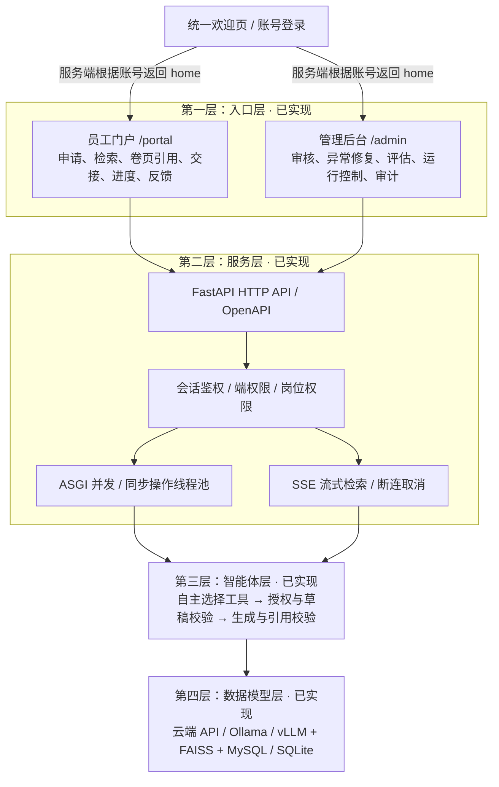

# 四层架构与本次交付

四层现已落到可执行代码：入口层、服务层、智能体层、数据模型层。模型和数据库地址可配置；默认不启用模型，保留原 SQLite 业务。完整接入步骤见 [模型与数据配置](model-setup.md)。

## 入口层

统一欢迎页 `/` 提供账号密码登录及演示账号提示。账号决定端，无需选择 C/B 端，也不能由请求中的 portal 字段提升权限。C/B 指工作界面，不改变档案开放范围。

| 端 | 账号 / 岗位 | 页面与工作内容 |
| --- | --- | --- |
| 员工门户 C | organizer 整理员、representative 查询代表 | 工作台、申请台账、进度、授权检索、卷页核对、我的交接、异常与反馈；具体写入仍按岗位限制 |
| 管理后台 B | reviewer 审核员 | 管理总览、权限核验、审核、退回、异常分派、交付、反馈核对 |
| 管理后台 B | engineer 工程师 | 异常处理、本地快照刷新；不能审批或扩大开放范围 |
| 管理后台 B | protector 保护专员 | 专员授权范围、审计、暂停和复盘恢复 |
| 管理后台 B | director 主任 | 管理总览、评估、脱敏审计、暂停；不能读取专员受限资料 |

未登录访问 `/portal`、`/admin` 返回欢迎页；访问错误工作端跳回账号所属端。员工调用 `/api/admin/overview` 返回 403。公共业务接口同时供双端使用，每个写操作仍有独立岗位、状态、责任人和版本校验，不能靠隐藏菜单保护数据。

右上角账号菜单选择“退出并更换账号”，返回欢迎页后使用另一账号登录。会话保存在 HttpOnly、SameSite=Strict Cookie 中，8 小时过期；HTTPS 下设置 Secure；退出和重新登录会使旧会话失效。当前六个演示账号按岗位建模，生产具名多账号、SSO 与密码生命周期尚未接入。

## 服务层

`src/arcsync/main.py` 为 ASGI 入口和安全响应头；`api/routes.py` 为 HTTP 路由、请求校验及 SSE；`api/security.py` 为会话、账号和端鉴权；`api/queries.py` 保留既有检索与卷页读取语义。原有 URL 与业务操作兼容。

- HTTP：JSON API、统一中文错误、32 KiB 写请求限制、同源请求校验，提供 `/api/openapi.json` 和离线可访问的 `/api/docs`。
- 并发：Uvicorn ASGI；同步数据库与密码校验在线程池执行；流式发送为异步生成器，等待网络时让出执行权。每次数据库操作独立连接，SQLite WAL 允许读写交错；写事务依然串行，`BEGIN IMMEDIATE` 与 revision 防止覆盖。
- 鉴权：服务端会话依赖、B 端权限与既有业务岗位规则；普通账号的流式结果和非流式结果都不包含受限资料。
- 流式响应：`GET /api/search/stream`，事件为 start → document（逐条）→ done；发送每条资料前复查会话，失效返回 expired 并结束。客户端通过 fetch 消费 SSE，重新检索、页面切换和退出时取消前次请求。不主动重连，避免静默重复结果。

流式检索基于已查询并校验过权限的本地结果快照，之后逐条发送，不是 AI 生成或逐页实时 OCR。流式发送期间不保持数据库连接或写事务；断连后停止继续发送。当前是本地演示规模，并发功能测试不能作为生产吞吐或容量承诺。多账号权限模型、生产身份认证与真实档案数据源仍待接入。

并发及流式实现参照 [FastAPI 并发说明](https://fastapi.tiangolo.com/async/) 和 [流式响应说明](https://fastapi.tiangolo.com/advanced/stream-data/)。

## 智能体层

`agents/orchestrator.py` 负责自主工具循环（最多10轮、20次工具、12条来源）、生成、来源和版本再校验；`agents/tools.py` 提供严格 Function Calling 工具；`agents/access.py` 负责本人查阅事项、版本绑定校验凭证、幂等草稿及人工提交，执行顺序不能由模型绕过。工具执行均保存人员、参数、结果与时间。详见 [档案智能体](autonomous-agent.md)。

模型通过原生 tool_calls 选择工具与参数，服务端按白名单及当前身份验证；数据库或系统命令不作为模型工具暴露。失败、重复调用、断连、超长输出、无效引用会停止，不保存为成功答案。流式 token 标为草稿，最终通过编号、权限、版本及内容校验才显示为辅助结果。该校验不等于语义真实性审查。

业务审批、责任交接、人工引用确认由 core/service.py 的确定性规则继续执行，智能体不直接改写业务状态。智能体本轮是单次任务编排，可查看历史运行；尚未实现跨轮长期对话记忆或自主后台任务。

## 数据模型层

- `data_models/config.py`：本地 .env 和环境变量、对话/嵌入独立端点、公开配置投影。
- `data_models/providers.py`：真实 HTTP 模型适配；Ollama JSON/NDJSON，云端及 vLLM 兼容 JSON/SSE。
- `data_models/knowledge.py`：带版本资料块导入、页码映射、权限与当前版本验证。
- `data_models/vectors.py`：真实 FAISS 归一化内积检索 + 关键词排名融合；业务库持久化向量缓存及本地快照。
- `data_models/mysql.py`：全业务 MySQL 建表、参数化连接适配、业务写锁、审计触发器；core/store.py 负责选用 MySQL 或兼容的 SQLite。

新增表：document_chunks、vector_embeddings、agent_runs、agent_steps。MySQL 不会自动覆盖或搬迁旧 SQLite；显式迁移脚本只允许空目标且保留源文件。原档案库/OCR/授权台连接协议继续由 integrations/base.py 预留。

## 多轮聊天扩展

`chat/routes.py` 将既有编排转换为已确认的聊天SSE协议，负责握手前错误、180秒总时限、断连取消和心跳；`chat/repository.py` 使用SQLite短事务保存会话/消息，按独立user_id授权并加载最近6轮有效历史。`core/accounts.py` 兼容迁移具名身份；前端为独立chat.html/chat.js/chat.css。已有智能体的run增加history/persist参数，聊天使用自己的消息表，不复制到旧岗位运行历史。
